# KIRO Push — поздравления и подарки для Remnawave Minishop

> [!TIP]
> **Плагин работает в [kirovpn](https://app.kiroproject.online/?campaign=gh_push&utm_source=github&utm_medium=readme&utm_campaign=kiro-push).** Посмотрите поздравления вживую в Telegram-боте [@marmeladki_app_bot](https://t.me/marmeladki_app_bot?start=gh_push).

[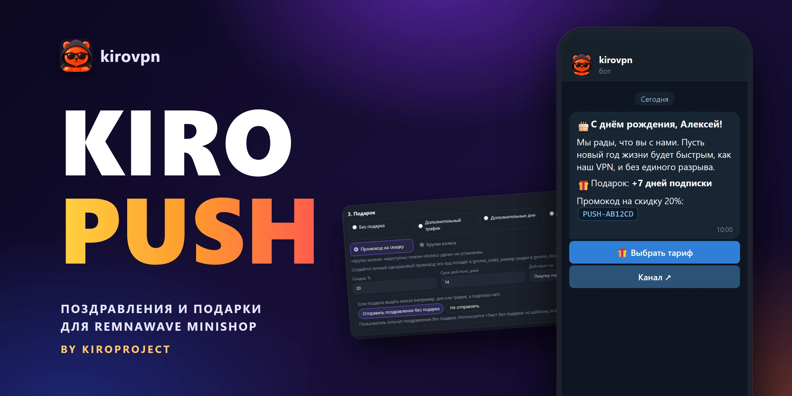](docs/cover.webp)

**KIRO Push** — плагин для [Remnawave Minishop](https://github.com/3252a8/remnawave-minishop), который сам отправляет клиентам тёплые сообщения в Telegram и дарит подарки: с днём рождения, с годовщиной регистрации, с Новым годом, с анонсом акции. Каждое событие настраивается в админке Minishop: аудитория, время, шаблон на русском и английском, кнопки и подарок (дни, трафик, деньги на баланс, персональный промокод или билеты колеса удачи). Без правок кода и без перезапуска бота.

Версия **0.1.0** · публикатор `kiroproject` · Minishop **3.8.0 и новее** (Plugin API v1)

## Возможности

* **Пять видов событий** — `birthday` (со смещением в днях: накануне, в день, после), `registration_anniversary` (годовщина регистрации, с настраиваемым минимумом лет), `fixed_date` (праздник каждый год, например Новый год), `one_time` (одна дата) и `manual` (только по кнопке «Запустить»).
* **Аудитория события** — подписка есть, пробная, платная или нет подписки; язык пользователя; конкретные тарифы. Заблокированные пользователи и те, кто заблокировал бота, исключены всегда.
* **Расписание** — время отправки `HH:MM` в часовом поясе плагина, правило для 29 февраля (28 февраля или 1 марта), догонка пропущенного после простоя сервера (по умолчанию 24 часа).
* **Шаблоны** — Telegram HTML, фото, видео, GIF и документы, кнопки (ссылка, Mini App, раздел магазина) с цветом и иконкой, custom emoji, подстановки и необязательные блоки `[[ ... ]]`, отдельный текст на случай, когда подарок выдать нельзя.
* **Подарки** — один на событие: трафик, дни, баланс, персональный одноразовый промокод со скидкой или билеты «Колеса удачи» ([kiro-wheel](https://github.com/kiroproject/kiro-wheel)). Выдача идемпотентна.
* **Даты рождения** — только из Telegram или от самого пользователя, один раз; сохранённая дата заблокирована, менять её может только поддержка.
* **Сканирование Telegram** — единоразовое возобновляемое сканирование существующих пользователей с «пробным запуском», который ничего не сохраняет.
* **Редактор в админке** — живой предпросмотр в пузыре Telegram, панель форматирования, эмодзи из библиотеки Minishop, загрузка медиа, тест себе, запуск с подтверждением, заготовки событий.
* **Доставка и диагностика** — журнал доставок с фильтрами и выгрузкой, журнал плагина, статистика. Идентификаторы и промокоды в выгрузках маскируются.
* **Надёжная работа** — один человек получает одно сообщение на событие за период, ограничение скорости, учёт `retry_after` Telegram, повторы, обработка блокировки бота. Сообщение, которое воркер начал отправлять и не завершил, повторно не отправляется: дубль хуже потери.

## Скриншоты

[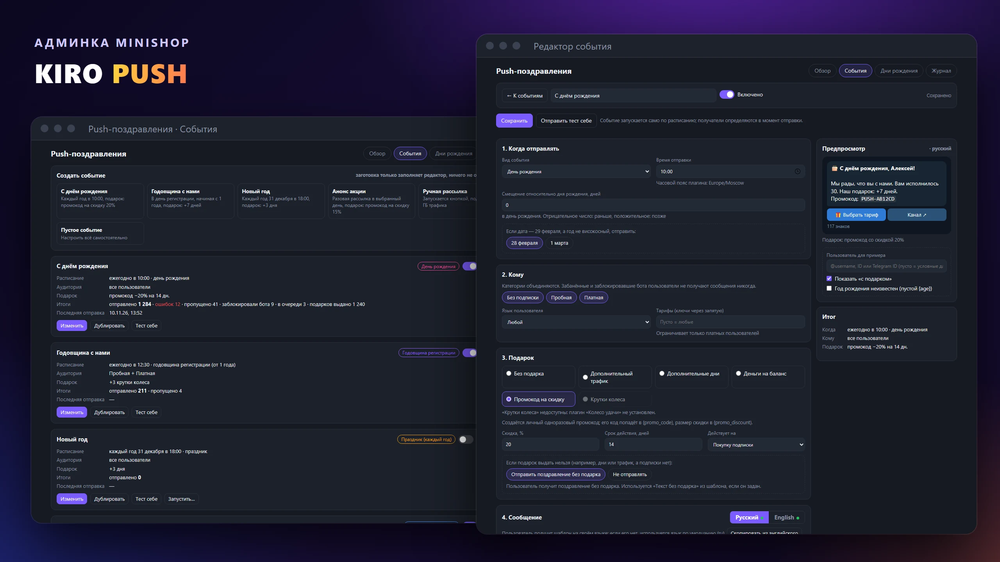](docs/overview.webp)

| Поздравление в Telegram | Карточка «День рождения» в Mini App |
| :---: | :---: |
| 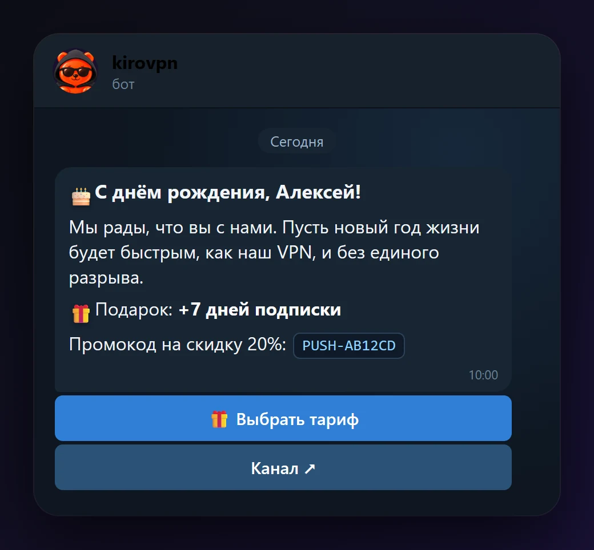 | 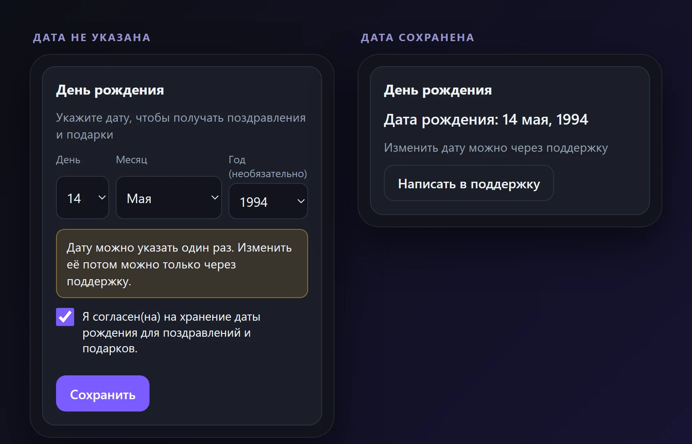 |

**Админка**

| Обзор и настройки | События |
| :---: | :---: |
| 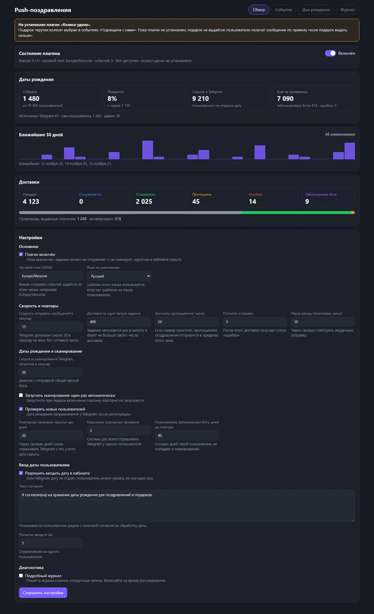 | 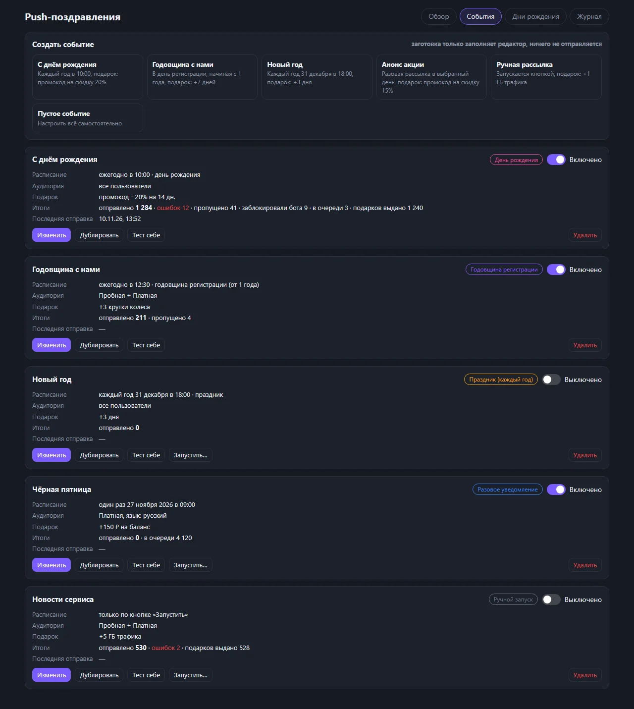 |

[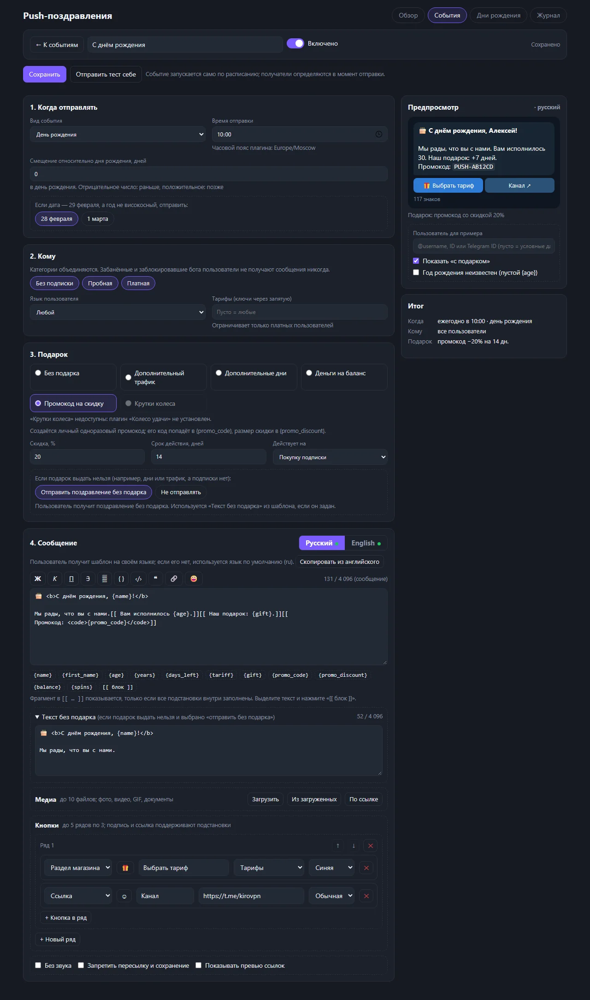](docs/screenshots/admin-editor.webp)

*Редактор события: расписание, аудитория, подарок, шаблон с живым предпросмотром, кнопки.*

| Светлая тема | Эмодзи из библиотеки |
| :---: | :---: |
| 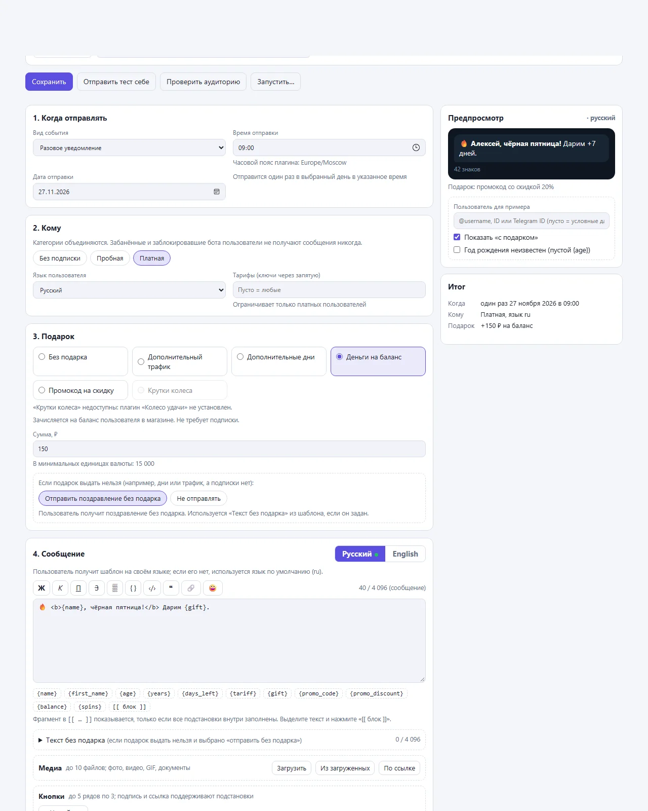 | 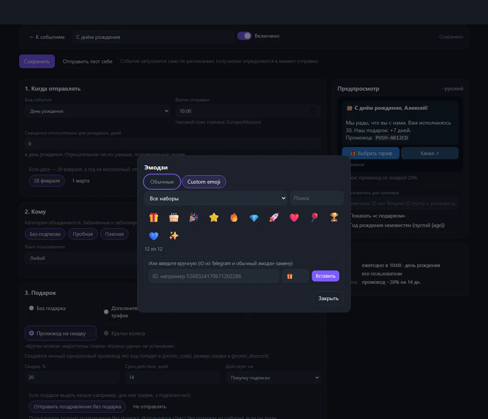 |

| Даты рождения | Журнал доставок | Журнал плагина |
| :---: | :---: | :---: |
| 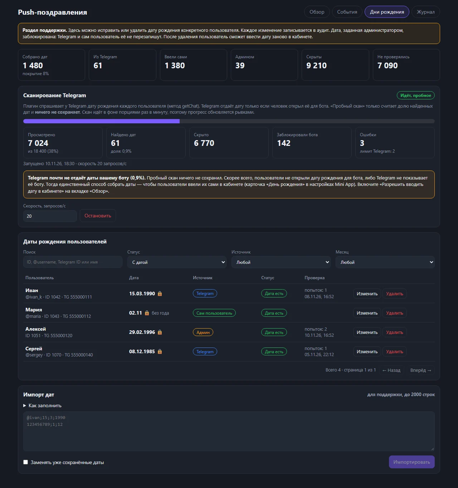 | 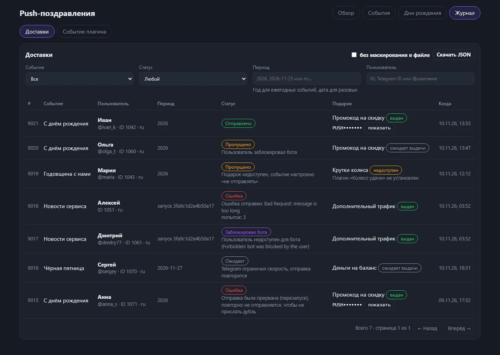 | 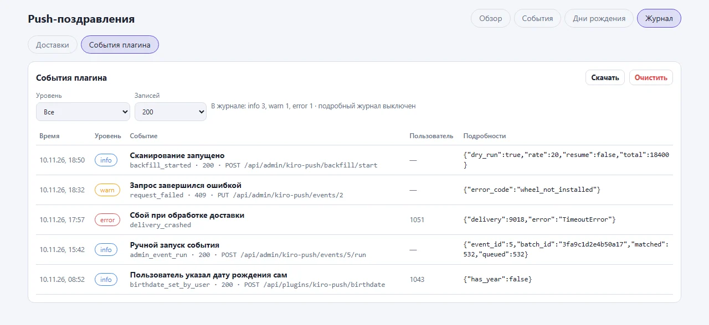 |

> Снимки админки сделаны на тестовых данных (`preview/`), имена и числа вымышленные.

## Установка

Плагин подписан публикатором `kiroproject` и устанавливается из репозитория по Git. Репозиторий публичный, в корне лежит `minishop-plugin.json` со ссылкой на готовый ZIP и его контрольной суммой.

1. В админке Minishop откройте раздел плагинов и выберите установку из Git-репозитория.
2. Укажите адрес репозитория:

   ```
   https://github.com/kiroproject/kiro-push
   ```

3. Сверьте отпечаток (fingerprint) публикатора `kiroproject` и подтвердите установку:

   ```
   901885f18638df2ee6cfa259f315f7f32987a62f7828f4568c78e3e8df16fc47
   ```

4. Включите плагин. Миграция `kiro-push.0001_initial` применится автоматически, Minishop перезапустит backend и worker.

Minishop проверяет репозиторий периодически и предложит обновление, когда выйдет новая версия. Готовые подписанные архивы и краткий список изменений лежат на странице [Releases](https://github.com/kiroproject/kiro-push/releases), полная история в [CHANGELOG.md](CHANGELOG.md).

**Вручную:** скачайте ZIP из Releases и загрузите его в разделе плагинов (Админка → Плагины → загрузить ZIP), проверьте отпечаток публикатора и включите плагин.

### Требования

* Remnawave Minishop **3.8.0 или новее** с Plugin API v1;
* возможности ядра: `user_ui`, `ui_composition`, `durable_jobs`, `rewards`; права наград: `rewards.days`, `rewards.traffic`, `rewards.balance`;
* публичный GitHub/GitLab-репозиторий для установки по Git (приватные Minishop не поддерживает);
* для подарка «крутки колеса» нужен установленный kiro-wheel; без него этот вид подарка недоступен.

## Быстрый старт

1. **Админка → Push → Обзор.** Проверьте часовой пояс (по умолчанию `Europe/Moscow`) и скорость отправки, включите плагин (`enabled`). Пока он выключен, задание ничего не делает, а карточка в кабинете скрыта.
2. **Даты рождения.** Откройте вкладку «Дни рождения» и запустите «Пробный запуск» сканирования Telegram: он ничего не сохраняет и показывает долю найденных дат. Если доля мала, это нормально (многие не открывают дату для ботов): основной источник будет ввод даты самими пользователями в кабинете. Затем запустите настоящее сканирование. По желанию включите `auto_backfill`, и оно стартует один раз при первом включении.
3. **Первое событие.** Вкладка «События» → выберите заготовку (например, «С днём рождения»). Заготовка только заполняет редактор и ничего не отправляет.
4. **Проверка.** Посмотрите предпросмотр, нажмите «Отправить тест себе» (подарок при этом **не выдаётся**).
5. **Включите событие.** Дальше задание само найдёт получателей и отправит сообщения в назначенное время.

## События и расписание

| Вид | Когда срабатывает | Параметры |
| --- | --- | --- |
| `birthday` | в день рождения со сдвигом | `offset_days` от -30 до 30 |
| `registration_anniversary` | в годовщину регистрации | `offset_days`, `min_years` от 1 до 50 |
| `fixed_date` | каждый год в заданный день | `date` в формате `MM-DD` |
| `one_time` | один раз | `date` в формате `YYYY-MM-DD` |
| `manual` | только по кнопке «Запустить» | нет |

* Время отправки задаётся по настенным часам часового пояса плагина (IANA); переход на летнее время учитывается, время в «пропавшем» часе сработает сразу после него.
* Пропущенную отправку задание догоняет в пределах `catchup_hours` (24) после назначенного времени.
* Для `birthday` и `registration_anniversary` ручной запуск недоступен; для `manual`, `one_time` и `fixed_date` есть «Пробный запуск» (число получателей и примеры) и запуск с подтверждением. Повторный запрос с тем же `batch_id` ничего не отправит дважды.
* Один человек получает не больше одного сообщения на событие за период: год для ежегодных событий, дата для `one_time`, номер пакета для ручных запусков.

Основные настройки плагина (полный список в [docs/api.md](docs/api.md)):

| Параметр | По умолчанию | Описание |
| --- | --- | --- |
| `enabled` | выключен | включает задание, отправку и карточку в кабинете |
| `timezone` | `Europe/Moscow` | часовой пояс расписания |
| `send_rate_per_second` | 15 | скорость отправки (1–28), у Telegram общий лимит на бота |
| `scan_rate_per_second` | 20 | скорость сканирования Telegram (1–28) |
| `batch_size` | 400 | доставок за один запуск задания |
| `catchup_hours` | 24 | окно догонки пропущенного |
| `max_send_attempts` / `retry_minutes` | 3 / 10 | число попыток отправки и пауза между ними |
| `rescan_missing_days` / `rescan_max_attempts` | 30 / 3 | повторная проверка скрытых дат |
| `user_entry_enabled` | включено | можно ли вводить дату в кабинете |

## Шаблоны и подстановки

Шаблон задаётся для русского и английского языков; если шаблона на языке пользователя нет, используется язык по умолчанию. Текст пишется в Telegram HTML (длина до 4096 знаков, подпись к медиа до 1024).

| Подстановка | Значение |
| --- | --- |
| `{name}`, `{first_name}` | имя пользователя |
| `{age}` | возраст (только при известном годе рождения) |
| `{years}` | лет с регистрации |
| `{days_left}` | дней до конца подписки (0, если подписки нет) |
| `{tariff}` | название тарифа |
| `{gift}` | описание подарка, например «+7 дней» |
| `{promo_code}`, `{promo_discount}` | персональный промокод и размер скидки |
| `{balance}` | баланс пользователя |
| `{spins}` | билеты колеса удачи (если плагин установлен) |

Значения экранируются как HTML. Фрагмент в **необязательном блоке** `[[ ... {age} ... ]]` показывается, только если все подстановки внутри заполнены (например, без года рождения фраза про возраст исчезнет целиком). Для случая, когда подарок выдать нельзя, у шаблона есть отдельный `text_no_gift`.

Пример:

```html
<b>С днём рождения, {name}!</b>

Мы рады, что вы с нами.[[ Вам исполнилось {age}.]][[ Наш подарок: {gift}.]]
[[ Промокод: <code>{promo_code}</code>]]
```

Кнопки: до 5 рядов по 3, виды `url`, `web_app` и `section` (раздел магазина, например тарифы), стиль `primary`, `success` или `danger`, иконка custom emoji или обычный эмодзи. Флаги: без звука, защита от пересылки, превью ссылок. Если Telegram отклоняет custom emoji, сообщение уходит с обычными.

## Подарки

На событие приходится один подарок. Он выдаётся **до** отправки сообщения и фиксируется в той же транзакции, поэтому повтор неудачной отправки подарок не дублирует.

| Вид | Что получает пользователь | Параметры |
| --- | --- | --- |
| `traffic` | дополнительные ГБ трафика, нужна активная подписка | `gb` |
| `days` | дни подписки, нужна активная подписка | `days` |
| `balance` | деньги на внутренний баланс | `amount_minor` (в админке вводится в основных единицах валюты) |
| `promo_discount` | персональный одноразовый промокод на скидку | `percent`, `valid_days` (14), `applies_to` (`subscription` или `all`) |
| `wheel_spins` | билеты колеса удачи, нужен kiro-wheel | `spins`, `ignore_cap` |

**Если подарок выдать нельзя** (например, дни или трафик, а подписки нет, либо не установлен kiro-wheel), действует правило события `gift_fallback`:

* `send_without_gift` — отправить поздравление без подарка (используется `text_no_gift`, если он задан);
* `skip` — не отправлять, доставка получает статус «пропущено» с причиной.

Промокоды и подарки видны в журнале доставок; промокод скрыт, пока вы не нажмёте на него.

## Даты рождения и конфиденциальность

* Дата рождения берётся **только** из Telegram (метод `getChat` отдаёт её, если пользователь открыл дату для бота) либо вводится **самим пользователем один раз** в кабинете после явного согласия. Других источников нет.
* Сохранённая дата **заблокирована**: Telegram её не обновляет, пользователь не может её изменить. Менять и удалять дату может только администратор (поддержка); каждое действие записывается в аудит.
* Если администратор удалил дату, пользователь может ввести её заново; Telegram удалённую запись не заполняет.
* Пользователям без видимой даты Telegram запрашивается повторно раз в 30 дней, не больше 3 раз. Если пользователь успел ввести дату сам, она не перезаписывается.
* Год рождения необязателен: `{age}` заполняется только при известном годе.
* Текст согласия (`consent_text`) меняется в настройках и показывается рядом с обязательной галочкой.

> [!IMPORTANT]
> Дата рождения относится к персональным данным. Оператор магазина сам отвечает за их обработку: опишите сбор и использование даты рождения (цель, срок хранения, порядок удаления) в своей политике конфиденциальности и при необходимости скорректируйте текст согласия.

## Журнал и диагностика

Раздел **Push → Журнал** состоит из двух частей.

* **Доставки** — фильтры по событию, статусу, периоду и пользователю; статусы `pending`, `sending`, `sent`, `skipped`, `failed`, `blocked`; состояние подарка; причины понятным языком; выгрузка в JSON (идентификаторы и промокоды маскируются, маскирование можно отключить).
* **Журнал плагина** — ошибки, отказы и ключевые действия (ввод и правка дат, сканирование, выдача подарков), фильтр по уровню, выгрузка текстом и очистка. Галочка «Подробный журнал» в настройках включает отладочные записи на время разбора проблемы.

Статистика на вкладке «Обзор»: собранные и скрытые даты, покрытие, именинники на 30 дней, доставки по статусам, использование выданных промокодов.

## HTTP API

Все запросы админки (`/api/admin/kiro-push/*`) и клиентская карточка (`/api/plugins/kiro-push/birthdate`) описаны в [docs/api.md](docs/api.md). Устройство плагина (таблицы, задание `tick`, конвейер доставки, идемпотентность, правила блокировки дат) описано в [docs/architecture.md](docs/architecture.md).

## Разработка

```
backend/kiro_push/     логика: планирование, доставка, подарки, шаблоны, даты рождения, сканирование Telegram
frontend/customer/     клиентская карточка «День рождения» (Mini App)
frontend/admin/        раздел админки «Push» (ES-модули без зависимостей, стили с префиксом kpu-)
locales/               строки ru и en
tests/                 тесты на временном PostgreSQL с заглушками ядра и Telegram
preview/               автономная проверка админки с подставным API (в пакет не входит)
docs/                  изображения, API и архитектура
```

Тесты (нужны `pgserver`, `sqlalchemy[asyncio]`, `asyncpg`, `aiohttp`, `node`; реальный Telegram не используется):

```bash
python tests/run_birthdates_tests.py
python tests/run_scheduler_tests.py
python tests/run_templates_tests.py
python tests/run_gifts_tests.py
python tests/run_api_tests.py
python tests/run_bundle_checks.py          # node --check бандлов, манифест, версии
node tests/admin_logic_test.mjs <корень плагина>   # логика админки; путь к каталогу плагина обязателен
```

Предпросмотр без сервера: выполните `python -m http.server 8765` в каталоге плагина и откройте `http://127.0.0.1:8765/preview/index.html?screen=overview` (также `events`, `editor`, `birthdates`, `journal`, `log`, `emoji`; `&theme=light` для светлой темы).

Сборка пакета: `python build.py kiro-push` из каталога `minishop-plugins` (скрипт сборки лежит в общем репозитории плагинов).

## Совместимость и ограничения

* Плагин проверен на заглушках ядра и Telegram. **На реальном Telegram не проверено:** доля пользователей, у которых `getChat` вернёт дату рождения (зависит от настроек приватности каждого пользователя, у большинства дата скрыта для ботов); условия, при которых Telegram принимает и показывает custom emoji в сообщениях бота (если Telegram отклоняет такое сообщение, плагин отправляет его повторно с обычными эмодзи; это поведение проверено только на заглушке).
* Версия 0.1.0 работает **только в Telegram**: пользователи без Telegram ID пропускаются.
* Подарок «крутки колеса» работает только при установленном kiro-wheel.
* Telegram ограничивает отправку примерно 30 сообщениями в секунду на бота; значение `send_rate_per_second` по умолчанию 15 оставляет запас для остальных уведомлений магазина.
* Строка доставки, прерванная в момент отправки, не повторяется и получает статус «ошибка»: возможна потеря одного сообщения вместо дубля.

## Лицензия

[MIT](LICENSE)
